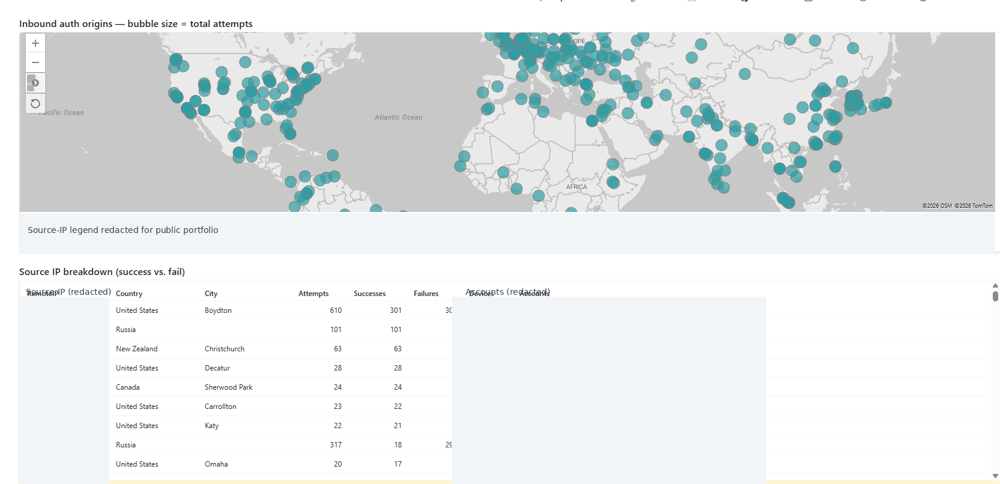

# Microsoft Sentinel | Inbound Authentication Origins & SOC Threat Hunting

**Cyber Range portfolio project** | Microsoft Sentinel · Microsoft Defender for Endpoint · Azure Log Analytics · KQL

## Project overview

This hands-on cybersecurity project demonstrates threat hunting and security monitoring using Microsoft Sentinel, Microsoft Defender for Endpoint, Azure Log Analytics, and Kusto Query Language (KQL).

The investigation focuses on analyzing inbound Windows authentication activity, identifying suspicious remote access patterns, evaluating authentication failures and successes, and visualizing the geographic origins of source IP addresses.

Using Microsoft Sentinel workbooks and endpoint security telemetry, I developed an investigative workflow to support the identification of potential brute-force attacks, unauthorized access attempts, and other suspicious authentication behavior.

**Project Objectives:**
- Analyze inbound authentication events using KQL.
- Investigate suspicious login failures and successful authentications.
- Visualize source IP geolocation using Microsoft Sentinel workbooks.
- Correlate authentication activity with endpoint telemetry.
- Identify potential indicators of compromise.
- Document findings and investigative limitations.

**Skills Demonstrated:** Threat Hunting | Microsoft Sentinel | Microsoft Defender XDR | KQL | SIEM Monitoring | Log Analysis | Incident Investigation | Security Visualization

> **Portfolio evidence:** The screenshot below comes from the actual workbook. IP addresses and account names were redacted for public sharing. Counts shown are observed dashboard values, not proof of malicious activity. This is a static screenshot, not a publicly accessible live workbook.

## Threat Hunting Methodology

This investigation follows a structured SOC threat-hunting workflow using Microsoft Sentinel, Microsoft Defender for Endpoint, and Kusto Query Language (KQL).

### 1. Authentication Log Analysis
- Examine Windows authentication events using `DeviceLogonEvents`.
- Identify repeated failed authentication attempts.
- Review successful logins for potentially suspicious access patterns.
- Analyze source IP addresses, targeted devices, and account activity.

### 2. Geographic Source Analysis
- Use `geo_info_from_ip_address()` to enrich public source IP addresses.
- Visualize inbound authentication origins through Microsoft Sentinel workbooks.
- Compare authentication activity across geographic regions.
- Identify unusual authentication patterns requiring further investigation.

### 3. Endpoint Investigation
- Review `DeviceProcessEvents` for suspicious process execution.
- Examine `DeviceNetworkEvents` for unusual network connections.
- Correlate authentication activity with related endpoint telemetry where available.
- Investigate potential indicators of compromise.

### 4. Threat Detection and Investigation
- Develop KQL queries to identify potential brute-force authentication behavior.
- Review authentication outcomes and suspicious remote access patterns.
- Use MITRE ATT&CK to classify relevant observed techniques when supported by evidence.
- Distinguish confirmed observations from potential security threats.

### 5. Documentation and Reporting
- Document investigative findings and relevant security telemetry.
- Preserve screenshots and supporting evidence.
- Identify limitations in available log data.
- Recommend additional investigation when evidence is inconclusive.

**Investigation Outcome:** Developed a repeatable threat-hunting workflow for examining inbound authentication activity, visualizing source IP origins, and supporting evidence-based SOC investigations.

## Inbound authentication origins map

The map plots geographically enriched authentication origins; the workbook labels bubble size as **total attempts**. The table provides **attempts, successes, failures, device counts, and accounts** by source IP.

## Investigation Results & Key Findings

### 1. Inbound Authentication Activity

The Microsoft Sentinel workbook provides a geographic visualization of inbound Windows authentication activity.

**Observations:**
- Authentication source IP addresses are distributed across multiple geographic regions.
- The workbook displays authentication activity using geographic markers.
- Source IP authentication outcomes can be examined to distinguish successful and failed login attempts.
- Geographic distribution provides investigative context but does not independently establish malicious activity.

### 2. Potential Brute-Force Activity

Repeated authentication failures originating from the same source IP address may indicate password guessing or brute-force attempts.

**Investigation Approach:**
- Group authentication events by source IP and targeted device.
- Count failed authentication attempts within a defined time window.
- Review targeted accounts and authentication outcomes.
- Investigate whether successful authentication followed repeated failures.

**MITRE ATT&CK:** T1110 — Brute Force (potential technique; requires supporting evidence).

### 3. Suspicious Remote Access Investigation

Authentication telemetry can support investigations into potentially unauthorized remote access.

**Investigation Approach:**
- Examine network and remote-interactive authentication events.
- Review source IP addresses, device names, and account activity.
- Correlate authentication events with endpoint process and network telemetry where available.
- Evaluate suspicious activity using additional evidence before determining whether compromise occurred.

### 4. Security Monitoring and Visualization

The Microsoft Sentinel workbook supports SOC investigations by presenting authentication activity in a visual format.

**Capabilities Demonstrated:**
- Geographic source IP visualization
- Authentication outcome analysis
- KQL-based security investigation
- Identification of potentially suspicious authentication patterns
- Evidence-based investigative documentation

### 5. Investigation Limitations

- Geographic IP locations are approximate.
- Authentication failures alone do not prove an attack.
- Successful authentication does not independently establish unauthorized access.
- The geographic map does not establish attacker identity or intent.
- Additional endpoint and authentication evidence is required to confirm compromise.

### Investigation Summary

This project demonstrates a structured approach to authentication threat hunting using Microsoft Sentinel, Microsoft Defender for Endpoint, Azure Log Analytics, and KQL.

The workbook provides visibility into inbound authentication origins and supports further investigation of potentially suspicious access patterns.

**Outcome:** Developed and documented a security-monitoring workflow that supports authentication analysis, threat hunting, and evidence-based SOC investigations.

### Investigation observations

- One displayed source has **317 attempts: 18 successes, 299 failures, across 28 devices**. This merits closer review for password spraying or other distributed targeting patterns, but the screenshot does not establish intent.
- Another displayed source has **610 attempts: 301 successes and 309 failures across 2 devices**. Mixed outcomes justify checking account identities, timing, and logon types.
- Other rows show sources with only successful logons. A success count alone is not evidence of compromise.
- IP geolocation is approximate; it does not establish the physical location of an attacker.

## Analyst workflow

1. Review time window, data freshness, and workbook filters.
2. Identify sources with unusual failure ratios, large device reach, or successful logons following failures.
3. Pivot to `DeviceLogonEvents` for affected devices, accounts, logon types, and timestamps.
4. Correlate with `DeviceProcessEvents`, `DeviceNetworkEvents`, and other available MDE telemetry.
5. Document evidence, alternative explanations, and recommended next steps. Do not claim compromise without corroborating evidence.

## Included KQL files

- [`queries/sentinel-inbound-authentication.kql`](queries/sentinel-inbound-authentication.kql) — starter authentication investigation query
- [`queries/mde-powershell-hunting.kql`](queries/mde-powershell-hunting.kql) — starter PowerShell investigation query
- [`queries/check-tables.kql`](queries/check-tables.kql) — workspace table validation

**Note:** The included queries are educational starting points and have not been verified against the workbook's exact schema or settings. The original workbook's KQL was not accessible from the provided private link.

## Tools and skills

Microsoft Sentinel, Microsoft Defender for Endpoint, Azure Log Analytics, Kusto Query Language, authentication analysis, geographic visualization, endpoint threat hunting, and incident investigation.

## Access and data handling

The source workbook is in an organization-controlled Microsoft security tenant. Recruiters may not have access to the live workbook. This repository provides a public, static view of the work. Before publishing, review the screenshot and queries for any remaining confidential details, and follow your organization's data-sharing policy.
